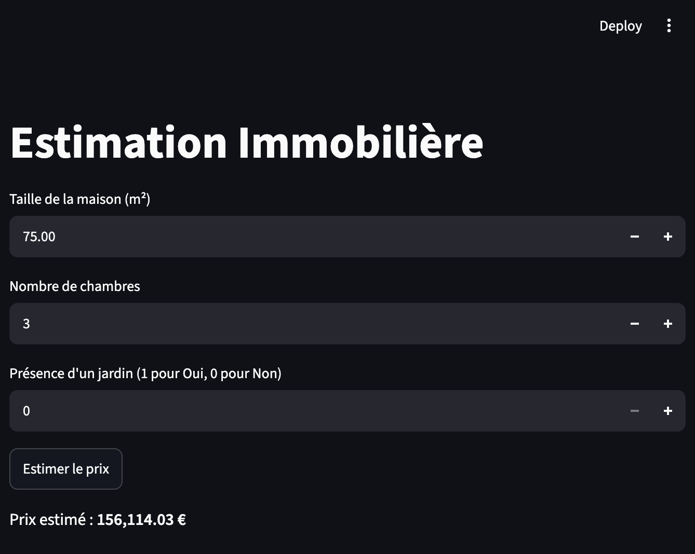
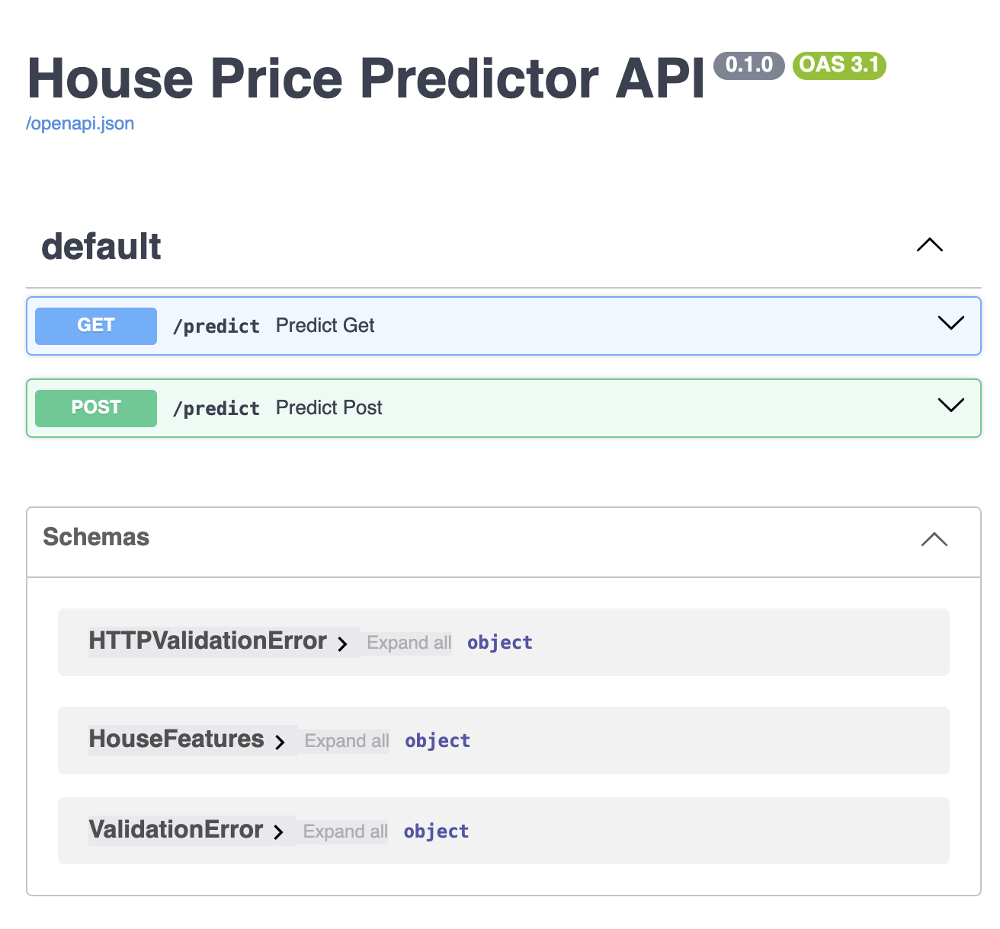
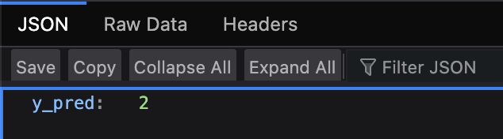
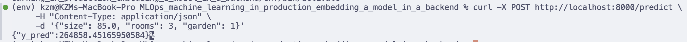
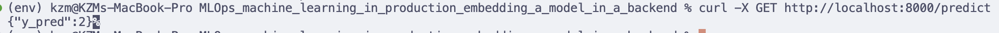
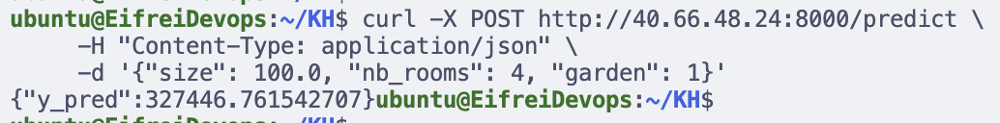

# House Price Prediction - MLOps API & UI

Déploiement de bout en bout d'un modèle de Machine Learning pour l'estimation de prix immobiliers, intégrant une interface Streamlit, une API REST FastAPI et la conteneurisation avec Docker.

## Structure du projet

```text
├── houses.csv             # Dataset d'entraînement
├── train_model.py         # Script d'entraînement du modèle
├── regression.joblib      # Modèle sérialisé
├── model_app.py           # Interface utilisateur Streamlit
├── api.py                 # API REST FastAPI
├── test_api.py            # Tests de l'API
├── requirements.txt       # Dépendances Python
└── Dockerfile             # Fichier de conteneurisation Docker
```

## 1. Installation locale

Activez votre environnement virtuel et installez les dépendances :

```bash
python3 -m venv env
source env/bin/activate
pip install -r requirements.txt
```

## 2. Entraînement du modèle

Pour régénérer le modèle sérialisé `regression.joblib` :

```bash
python train_model.py
```

## 3. Lancement de l'interface Streamlit

Pour tester le modèle via l'interface interactive :

```bash
streamlit run model_app.py
```

L'application est accessible sur http://localhost:8501.



## 4. Lancement de l'API FastAPI (Local)

Pour démarrer le serveur API de prédiction :

```bash
uvicorn api:app --reload --port 8000
```

* **Swagger UI (Documentation interactive) :** http://localhost:8000/docs



* **Endpoint de prédiction :** POST http://localhost:8000/predict



Exemple de requête :

```bash
curl -X POST http://localhost:8000/predict \
     -H "Content-Type: application/json" \
     -d '{"size": 85.0, "rooms": 3, "garden": 1}'
```

Réponse :

```json
{
  "y_pred": 245000.0
}
```




## 5. Déploiement avec Docker en local

### Construction de l'image

```bash
docker build -t ml-house-api .
```

### Lancement du conteneur

```bash
docker run -d -p 8000:8000 --name house_api ml-house-api
```

### Vérification

```bash
curl -X GET http://localhost:8000/predict
```




## 6. Déploiement sur la machine virtuelle dans le cloud

### Accès à la VM via SSH :

```bash
ssh ubuntu@40.66.48.24
# Mot de passe : Supermotdepass42!
```

### Transférer les fichiers vers la VM :

Depuis votre machine locale :

```bash
scp Dockerfile requirements.txt api.py regression.joblib ubuntu@40.66.48.24:/home/ubuntu/KH/
```

### Construire et lancer le conteneur Docker sur la VM :

Connectez-vous à la VM, placez-vous dans votre dossier et exécutez :

```bash
sudo docker build -t ml-house-api .
sudo docker run -d -p 8000:8000 --name ml_api_kh ml-house-api
```

### Tester l'API déployée sur la VM :

Depuis votre machine locale :

```bash
curl -X POST http://40.66.48.24:8000/predict \
     -H "Content-Type: application/json" \
     -d '{"size": 100.0, "nb_rooms": 4, "garden": 1}'
```


